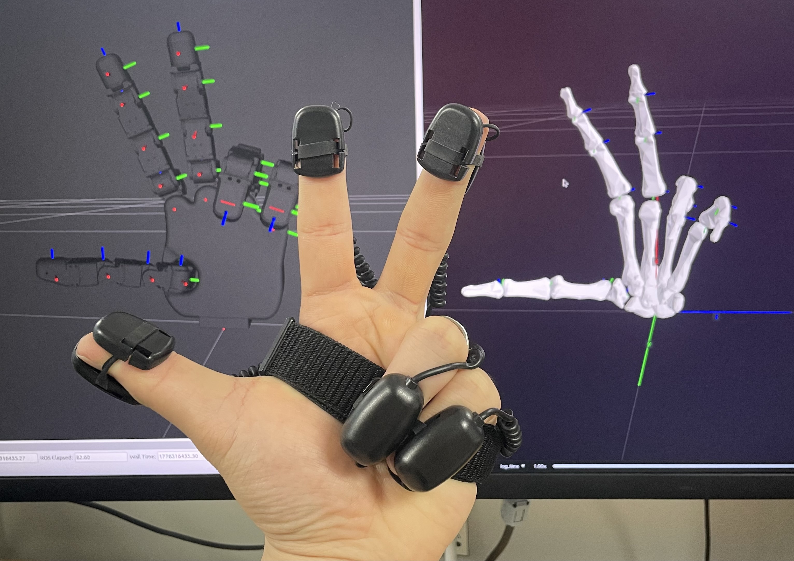

<p align="center"></p>

<h1 align="center">airglove_ros2</h1>

<p align="center"><a href="README.md">English</a> | <b>한국어</b></p>

<p align="center">
  <a href="LICENSE"></a>
  <a href="https://docs.ros.org/en/jazzy/"></a>
  
</p>

주식회사 왓츠랩(WHATs LAB Corp)의 데이터 글러브 **AirGlove** 용 ROS 2 드라이버와 손 리타게팅입니다.
드라이버는 글러브 미들웨어 Spine 이 보내는 값(손마다 OpenXR 26관절, 손목 IMU, 장치 상태, 알람)을
그대로 발행하고 손가락 햅틱을 받습니다. 리타게팅 패키지는 손 관절을 로봇 손 관절각으로 바꿉니다.

<p align="center"></p>

## 패키지

| 패키지 | 역할 | 의존 |
|---|---|---|
| `airglove_msgs` | Spine 메시지마다 하나: `HandJoints`, `WristOrientation`, `DeviceStatus`, `Alarm`, `Haptics`, `HapticsResult` | — |
| `airglove_driver` | Spine 3.0.0 → 토픽, 햅틱 → 글러브. 글러브를 여는 유일한 노드. | [AirGlove-Client](https://github.com/whats-lab/AirGlove-Client) (pip) |
| `airglove_retargeting` | `HandJoints` → 로봇 손 `JointState`(GeoRT 소프트 프롬프트 신경망), 관절 명령 `safety_gate`, `hand_view` | [whatslab-sdk](https://github.com/whats-lab/whatslab-sdk) (pip) |

Spine 은 PC 당 클라이언트 하나(UDP 4040)에만 보내므로 `airglove_driver` 는 Spine PC 에서 돌립니다.
리타게팅 노드는 토픽만 구독하므로 ROS 네트워크의 어느 PC 에서든 돌릴 수 있고,
`airglove_msgs/HandJoints` 를 내는 다른 소스(헤드셋 핸드트래킹 브리지 등)도 입력으로 받습니다.

## 토픽

| 토픽 | 타입 | 방향 | 설명 |
|---|---|---|---|
| `/airglove/{left,right}/joints` | `airglove_msgs/HandJoints` | 드라이버 → | 새 손 프레임마다(Spine 주기). 26 × `[qx qy qz qw px py pz radius]`, 손목 기준, m, OpenXR 관절 순서·축. `valid[26]` |
| `/airglove/{left,right}/wrist` | `airglove_msgs/WristOrientation` | 드라이버 → | Spine 이 보내는 손등 IMU 원시 quat(`[y, x, z, -w]`). 손목 자세가 아님 |
| `/airglove/status` | `airglove_msgs/DeviceStatus` | 드라이버 → | 1 Hz: 글러브 연결, Spine 프로토콜(3), heartbeat 경과 |
| `/airglove/alarm` | `airglove_msgs/Alarm` | 드라이버 → | `RESTART`, `ATLAS_DEVICE_ERROR` |
| `/airglove/{left,right}/haptics` | `airglove_msgs/Haptics` | → 드라이버 | 세기 5개(엄지..새끼), 0 끔 · 1 약 · 2 중 · 3 강 |
| `/airglove/{left,right}/haptics_result` | `airglove_msgs/HapticsResult` | 드라이버 → | 마지막 햅틱 명령 결과 |
| `/joint_states` | `sensor_msgs/JointState` | 리타게팅 → | 로봇 손 관절. `hand_type:=both` 면 `/{side}_hand/joint_states` |

진동시키는 동안에는 `Haptics` 를 계속 발행해 주세요. 드라이버는 `haptics_timeout`(1초) 동안 명령이
없으면 0 을 보냅니다(`0` 이면 0 을 보낼 때까지 마지막 명령을 유지합니다). 또 그 햅틱 토픽에 발행하는
노드가 없어지거나(보내던 노드가 죽은 경우 등, 1초마다 확인) 드라이버가 종료할 때 0 을 보냅니다. 끄기는
0.2초 간격으로 최소 두 번 보내고, Spine 이 확인(`success` true)할 때까지 최대 5초 동안 다시 보냅니다.
발행자가 0 을 반복해 보내도 다시 전달하지 않습니다. Spine 도 드라이버가 3초 동안 응답이 없으면 끕니다.

## 설치

ROS 2 Jazzy, Ubuntu 24.04. colcon 과 rclpy 가 시스템 Python 에서 돌기 때문에 pip 패키지도 시스템 Python 에
설치합니다. Ubuntu 24.04 는 이 Python 을 외부 관리 환경(PEP 668)으로 막아 두므로 `--break-system-packages` 를 붙입니다.
numpy 는 `<2` 로 고정합니다(Jazzy 시스템 패키지가 numpy 1.x 기준으로 빌드됨).

```bash
cd ~/ros2_ws/src && git clone https://github.com/whats-lab/whatslab-ros2.git airglove_ros2
pip install --break-system-packages -r airglove_ros2/requirements.txt  # airglove-client, whatslab-sdk, dexhand-description
cd ~/ros2_ws && colcon build && source install/setup.bash
```

드라이버만 쓸 때(whatslab-sdk 불필요): `pip install --break-system-packages -r airglove_ros2/airglove_driver/requirements.txt`,
`colcon build --packages-up-to airglove_driver`.

### 리타게팅 엔진

`retarget` 로 엔진을 고릅니다 (기본 `geort:orca_right`).

| `retarget` | 엔진 | 필요한 것 | `robot_urdf` (dexhand-description) |
|---|---|---|---|
| `geort:orca_right` | GeoRT 소프트 프롬프트 | — (모델은 whatslab-sdk 에 동봉) | `orca_hand/urdf/{side}.urdf` (기본, `{side}` = left/right) |
| `geort:hx5_right` | GeoRT 소프트 프롬프트 | — (모델은 whatslab-sdk 에 동봉) | `robotis_hx5_d20/urdf/hx5_d20_right.urdf` |
| `dex:orca`, `dex:allegro`, `dex:leap`, `dex:ability`, `dex:schunk`, `dex:dg5f`, `dex:robotis` | dex-retargeting DexPilot | `pip install --break-system-packages 'whatslab-sdk[hand] @ git+https://github.com/whats-lab/whatslab-sdk.git@v0.5.0' 'numpy<2.0'` (torch) | 해당 손 URDF |

GeoRT 는 numpy 만으로 돕니다. 학습된 모델은 whatslab-sdk 에 함께 들어 있고, 다른 모델을 쓰려면
`WHATSLAB_GEORT_MODEL` 로 지정하세요. 모델은 오른손용이고 왼손 글러브는 좌우 반전해서 씁니다 — 그래서
왼손 입력도 **오른손 로봇 관절**을 냅니다. `robot_urdf` 에 `{side}` 가 있으면 노드가 오른손 URDF 를 알아서 고릅니다. Allegro·DG-5F-S
프롬프트도 들어 있지만 관절 이름이 아직 dexhand-description 에 없는 URDF 기준입니다.
DexPilot 은 whatslab-sdk 의 `configs/hands/<손>_<side>.yaml` 이 있는 URDF 면 어떤 손이든 됩니다.

## 사용

```bash
ros2 launch airglove_retargeting retargeting.launch.py                 # 드라이버 + 리타게팅 (오른손)
ros2 launch airglove_retargeting retargeting.launch.py hand_type:=both
ros2 launch airglove_retargeting retargeting.launch.py driver:=false   # 리타게팅만
ros2 launch airglove_driver driver.launch.py                           # 드라이버만
ros2 run airglove_driver haptics_keyboard --ros-args -p side:=left     # 햅틱 테스트 (키 0-3)
ros2 launch airglove_retargeting hand_view.launch.py gui:=false        # rviz (기본 orca_hand 오른손)
```

`hand_type:=both` 는 `/{side}_hand/joint_states` 로 나눠 발행합니다. `hand_view` 는 `/joint_states` 로 한 손만
보여 주므로, 한쪽을 보려면 relay 해 주세요(패키지 `ros-jazzy-topic-tools`):
`ros2 run topic_tools relay /left_hand/joint_states /joint_states` 와 `hand_view.launch.py gui:=false`.
`hand_view` 의 `side` 는 로봇 손 쪽입니다. `geort:orca_right` 면 왼손 글러브여도 `right` 입니다.

| 노드 | 파라미터 |
|---|---|
| `airglove_driver` | `pair`(1), `listen_port`(4040), `spine_port`(4042), `publish_hz`(120), `haptics_timeout`(1.0 s, 0 = 끔; haptics_keyboard 재전송 주기인 0.3 s 보다 길게) |
| `airglove_retargeting` | `hand_type`(`left`\|`right`\|`both`), `retarget` (`geort:orca_right`), `robot_urdf`(리타게팅 대상이 아닌 관절 0 채움), `input_namespace`(`/airglove`) |
| `safety_gate` | `robot_description`, `limits_override`, `timeout`, `output_hz`, `enable_deadman` — sub `~/command_raw` → pub `~/command_safe`; srv `~/estop`, `~/reset`; sub `~/enable` |

## 호환성

Spine **3.0.0**(OSC 프로토콜 3), AirGlove-Client 0.4.0 을 씁니다. Spine 과 `airglove_driver` 는 같은 PC 에서
돌아야 합니다. Spine 2.x 는 지원하지 않습니다 — Spine 2.3.1 미만은 whatslab-ros2 0.1.0(`atlas_hand`)을
쓰시고, Spine 2.3.x 는 어느 릴리스에서도 지원하지 않습니다.

0.1.0(`atlas_hand`)에서 옮길 때:

| 0.1.0 | 지금 |
|---|---|
| `atlas_hand.launch.py` | `airglove_retargeting retargeting.launch.py` |
| 햅틱 `/{left,right}_hand/haptic` 의 `Int32MultiArray`, `…/haptic/off` 의 `Empty` | `/airglove/{left,right}/haptics` 의 `airglove_msgs/Haptics` (모두 0 = 끔) |
| `input_source:=meta_quest`(Quest 손 입력), 사람 손 TF | 없어졌습니다 — 직접 만든 브리지에서 `airglove_msgs/HandJoints` 를 발행하세요 |
| `atlas_arm_teleop` / `arm_teleop.launch.py` | 없어졌습니다 — 0.1.0 을 계속 쓰세요 |

## 라이선스

**주식회사 왓츠랩(WHATs LAB Corp) 소스 코드 라이선스**(CC BY-NC-ND 4.0 기반)를 따릅니다
— source-available, 비영리, 2차 저작물 금지. 자세한 내용은 [LICENSE](LICENSE) 를 참고하세요.

Copyright © 주식회사 왓츠랩(WHATs LAB Corp). All rights reserved.
