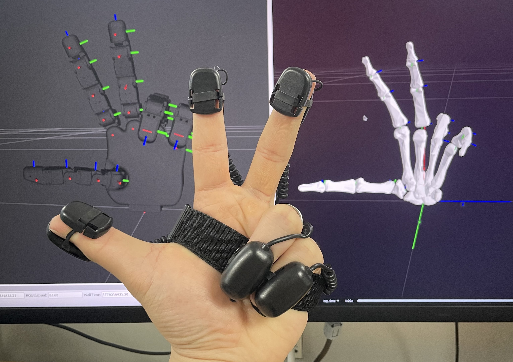

<p align="center"></p>

<h1 align="center">whatslab-ros2</h1>

<p align="center"><b>English</b> | <a href="README.ko.md">한국어</a></p>

<p align="center">
  <a href="LICENSE"></a>
  <a href="https://docs.ros.org/en/jazzy/"></a>
  
</p>

**whatslab-ros2** is a thin ROS 2 wrapper that exposes the
[whatslab](https://github.com/whats-lab/whatslab-sdk) teleoperation SDK as ROS 2 nodes.
All logic — input receiving, hand/arm retargeting, IK, safety — lives in `whatslab`;
this package only wires it to ROS 2 topics, services, and launch files.

<p align="center"></p>

## Nodes

The ament package is named `atlas_hand`. It ships three executables:

| Executable | Role | Key topics / services |
|---|---|---|
| `atlas_hand` | Hand-only: whatslab receiver → hand retargeting | pub `/joint_states`; sub haptic feedback |
| `atlas_arm_teleop` | Arm + hand: whatslab `GloveModel` | pub `/joint_states`, `/arm/joint_trajectory`; srv `~/calibrate` |
| `safety_gate` | `whatslab.safety` clamp · rate-limit · watchdog · e-stop | sub `~/command_raw` → pub `~/command_safe`; srv `~/estop`, `~/reset`; sub `~/enable` |

### Key parameters

- **`atlas_hand`** — `input_source` (`atlas`\|`meta_quest`), `hand_type` (`left`\|`right`\|`both`), `robot_config`, `server_port` (AirGlove OSC, 4040), `osc_port` (Quest OSC, 9000)
- **`atlas_arm_teleop`** — `rig`, `controller_side`, `hand_side`, `quest_port`, `glove_port`, `publish_hz`, `arm_traj_time` (hand config is derived from the rig)
- **`safety_gate`** — `robot_description`, `limits_override`, `timeout`, `output_hz`, `enable_deadman`

## Installation

Requires ROS 2 Jazzy and the `whatslab` SDK (installed via pip). numpy is pinned `<2`.

```bash
# 1) whatslab SDK + deps (in your ROS 2 Python environment)
pip install -r requirements.txt      # whatslab-sdk[hand,receiver] @ git + numpy<2

# 2) build in your colcon workspace
cd ~/ros2_ws && colcon build --packages-select atlas_hand && source install/setup.bash
```

URDF/meshes come from the [`dexhand-description`](https://github.com/whats-lab/dexterous-hand-urdf)
package (pulled in by whatslab's `hand`/`arm` extras).

## Usage

```bash
ros2 launch atlas_hand atlas_hand.launch.py      # hand-only teleop
ros2 launch atlas_hand arm_teleop.launch.py      # arm + hand teleop
ros2 launch atlas_hand hand_view.launch.py       # rviz view
```

For **Meta Quest** input, install the PoseDataTracker APK from the
[whatslab-sdk](https://github.com/whats-lab/whatslab-sdk) repo (`assets/quest/`) onto the
headset and connect it to the same Wi-Fi. The **AGA glove** is available from
[WHATs LAB](https://www.whatslab.co.kr/).

## Compatibility

Data-glove teleoperation goes through **Spine**, WHATs LAB's glove middleware.
Supported Spine versions: **below 2.3.1** (2.3.1 and newer are not yet supported).

## License

Licensed under the **주식회사 왓츠랩 (WHATs LAB Corp) Source Code License** (based on
CC BY-NC-ND 4.0) — source-available, non-commercial, no derivatives. See [LICENSE](LICENSE).

Copyright © 주식회사 왓츠랩 (WHATs LAB Corp). All rights reserved.
